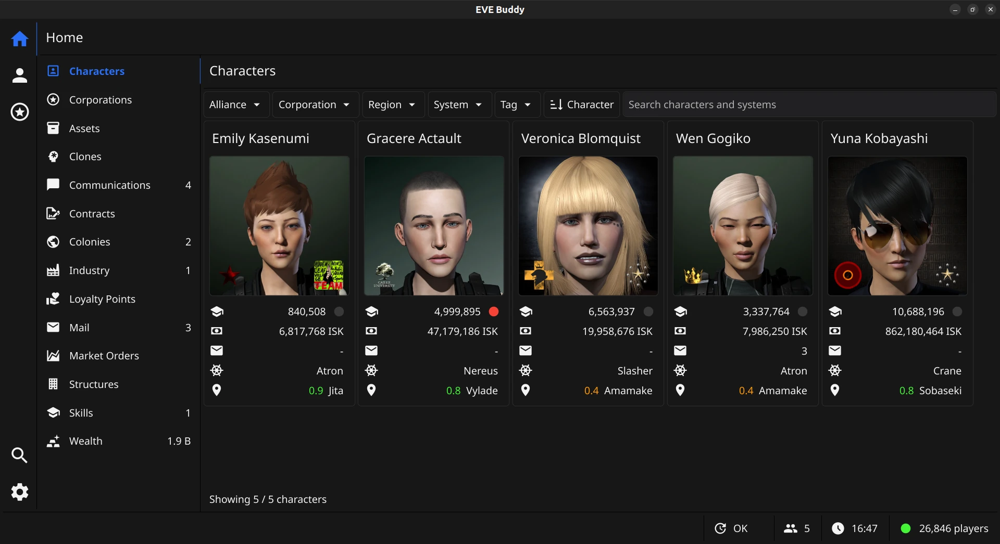
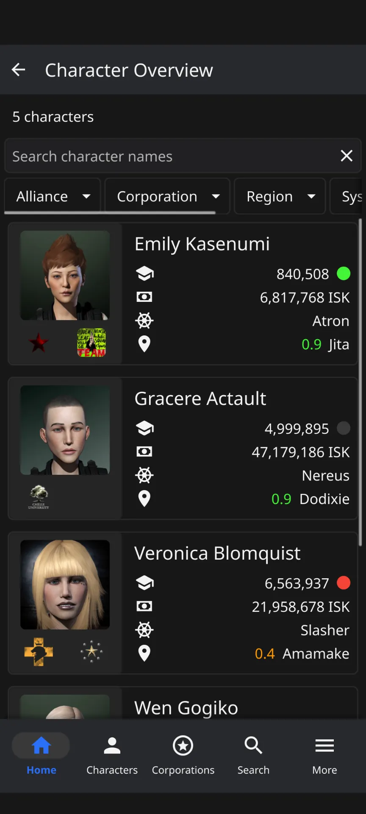

<h1> EVE Buddy</h1>

[&replace=%241&label=Fyne&cacheSeconds=https%3A%2F%2Fgithub.com%2Ffyne-io%2Ffyne)](https://github.com/fyne-io/fyne)

A multi-platform companion app for [EVE Online](https://www.eveonline.com/) players. Free and open source. Available on Windows, Linux, macOS and Android.

**[Website](https://evebuddy.kalkoken.net/)** · **[Discord](https://discord.gg/tVSCQEVJnJ)**

&nbsp;&nbsp;&nbsp;

## Features

- **Consolidated views**: All your characters and corporations in one view per topic, with answers the game can't give you at a glance – assets, colonies, industry jobs and more
- **Character monitor**: Keep track of each character – training queue, assets, clones, wallet and more
- **Corporation monitor**: Keep your corporation running – structures, wallets, industry jobs and members
- **Notifications**: Get notified about structure attacks, new mail, empty training queues and more
- **New Eden search**: Search live on the game server for characters, corporations, systems, types and more
- **Information windows**: Details for most objects on screen, just like the in-game information windows
- **Mail client**: Full mail client for all your characters
- **Automatic updates**: Data for all your characters and corporations is updated automatically in the background
- **Run in background**: Keeps running and notifying you while you do something else, like playing EVE. Desktop only

See the [website](https://evebuddy.kalkoken.net/) for all features, install guides and support.

## Support & Contribution

For bugs and feature requests, please open an [issue](https://github.com/ErikKalkoken/evebuddy/issues). For questions, join the **#eve-buddy** channel on our [Discord](https://discord.gg/tVSCQEVJnJ).

Contributions are welcome! Feel free to open a pull request, or discuss your idea on Discord first.

## Credits

The forecasts for planetary industry colonies are based on the colony simulation in [RIFT Intel Fusion Tool](https://gitlab.com/rift-intel-fusion-tool/rift-intel-fusion-tool) by Nohus and used with permission.

Built with the [Fyne](https://fyne.io/) GUI toolkit, licensed under the [BSD 3-Clause License](https://github.com/fyne-io/fyne/blob/master/LICENSE).

Icons are from [Material Design Icons](https://pictogrammers.com/library/mdi/) by Pictogrammers, licensed under the [Apache License 2.0](https://github.com/Templarian/MaterialDesign/blob/master/LICENSE).

"EVE", "EVE Online", "CCP", and all related logos and images are trademarks or registered trademarks of CCP hf.
